# Restaurant App MVP (React Native and Express)

A mobile restaurant management prototype built with React Native and Expo (SDK 57) for Mobile App Development, Fall 2026.

---

## A2 Backend (Q2-Q7 server)

The Express API is in the root `server/` folder. It uses MongoDB database `restaurant_app`.
The app API address is set in one place, `src/api/client.js`, as `http://192.168.1.3:5000`. Change the IP when the laptop address changes; Android emulator uses `http://10.0.2.2:5000`.

### Run the server

1. In a terminal, run `cd server` and `npm install`.
2. Copy `.env.example` to `.env`, then paste your MongoDB connection string into `MONGO_URI`. Keep `.env` private.
3. Seed the database with `npm run seed`.
4. Start the API with `npm run dev` (or `npm start`). It listens on `0.0.0.0:5000`.
5. Open `http://<laptop-IP>:5000/api/health` from a phone on the same Wi-Fi. For Android emulator use `http://10.0.2.2:5000/api/health`.

Seeded logins (password for both: `Pass1234`):

| Role | Email |
| --- | --- |
| Customer | `customer@test.com` |
| Manager | `manager@test.com` |

### API endpoints

Protected requests use `Authorization: Bearer <token>`. Manager endpoints require a manager token.

| Method | Endpoint | Access | Request | Response |
| --- | --- | --- | --- | --- |
| GET | `/api/health` | Public | None | Status and server time |
| POST | `/api/auth/register` | Public | Name, email, password, role | Token and public user; 409 for an existing email |
| POST | `/api/auth/login` | Public | Email, password | One-day token and public user |
| GET | `/api/auth/me` | Signed in | None | Current public user |
| GET | `/api/menu` | Public | Optional category and search query | Matching menu items |
| GET | `/api/menu/:id` | Public | None | One item; 400 invalid id, 404 missing item |
| POST | `/api/menu` | Manager | Name, description, price, category, image, flags | Created item (201) |
| PUT | `/api/menu/:id` | Manager | Menu fields to update | Updated item |
| DELETE | `/api/menu/:id` | Manager | None | Delete message |
| GET | `/api/tables` | Signed in | None | Tables and seat counts |
| GET | `/api/reservations/availability` | Signed in | Date, timeSlot, partySize query | Free tables with enough seats |
| POST | `/api/reservations` | Signed in | Table, date, timeSlot, partySize, phone | Created booking; 409 if taken |
| GET | `/api/reservations/my` | Signed in | None | Current user's bookings |
| GET | `/api/reservations` | Manager | None | All bookings |
| PATCH | `/api/reservations/:id` | Owner or manager | Cancelled, Accepted, or Declined | Updated booking |
| POST | `/api/orders` | Signed in | Item ids, quantities, notes, type, promo, table or pickup time | Order with server-calculated total |
| GET | `/api/orders/my` | Signed in | None | Current user's orders |
| GET | `/api/orders` | Manager | None | All orders |
| PATCH | `/api/orders/:id/status` | Owner cancel or manager | Next status | Updated order |

Use the exported `A2/restaurant-api.postman_collection.json` collection to exercise the routes, including authorization and validation failures.

## Installation & Setup

### Prerequisites
- **Node.js**: v20 or v22 LTS recommended
- **Expo Go App**: Version supporting Expo SDK 57 on your mobile device (iOS / Android)

### Installation Steps
1. Clone the repository and navigate to the project directory:
   ```bash
   cd restaurant-app-mvp
   ```
2. Install dependencies:
   ```bash
   npm install
   ```
3. Start the Expo development server:
   ```bash
   npx expo start
   ```
4. Scan the QR code using the **Expo Go** app on your phone.

---

## Seeded Login Credentials

The app authenticates with the server. Both seeded accounts use password `Pass1234`:

| Role | Email | Password | Destination Screen |
| :--- | :--- | :--- | :--- |
| **Customer** | `customer@test.com` | `Pass1234` | Menu Browsing Screen (`MenuScreen`) |
| **Manager** | `manager@test.com` | `Pass1234` | Manager Dashboard (`DashboardScreen`) |

---

## Q4 note

### What happens if the filtering effect dependency array is left empty?

> In React, if the filtering `useEffect` dependency array is left empty (`[]`), the effect callback executes only once when the component initially mounts. At mount time, `menuItems` is an empty array (`[]`) because the 1.5-second Promise has not yet resolved, and `selectedCategory` is initialized to `'All'`. Consequently, `filteredItems` is set to an empty array and is never updated again. Even when the menu items finish loading or the user taps different category chips (e.g., Starters or Mains), React does not re-run the effect because none of the watched dependencies trigger it. The screen remains completely blank with zero items shown.

---

## Q6 note

Context suits authentication and theme state because many screens need the same user and palette.
Providers make that shared data available without passing props through every navigator and screen.
A login updates one shared user value, and logout clears it for the whole navigation tree.
A theme toggle updates one shared palette, so all subscribed screens can change together.
This keeps screen props focused on screen-specific data and actions.
One drawback is that all consumers re-render when a context value they use changes.

## Q7 cart reducer cases

| Action | Initial state | Expected state |
| --- | --- | --- |
| `ADD_ITEM` (m1) | `items: []` | m1 added with quantity 1 and an empty note |
| `ADD_ITEM` (m1 again) | m1 quantity 1 | m1 quantity becomes 2, with one cart row |
| `INCREMENT` (m1) | m1 quantity 1 | m1 quantity becomes 2 |
| `DECREMENT` (m1) | m1 quantity 1 | m1 row is removed at quantity zero |
| `UPDATE_NOTE` (m1, "no onions") | m1 note empty | m1 note becomes "no onions" |
| `REMOVE_ITEM` (m1) | cart contains m1 | items becomes empty |
| `APPLY_PROMO` (`WELCOME10`) | no promo | promo is `WELCOME10`, discount is 10% |
| `APPLY_PROMO` (`INVALID`) | no promo | state is unchanged; Cart shows an invalid-code alert |
| `CLEAR_CART` | items and promo set | items empty, promo cleared, discount is 0% |
| `REMOVE_PROMO` | promo is `FEAST20` | promo cleared, discount is 0% |

### useReducer and useState for the cart

`useReducer` keeps related cart changes together as named actions.
The reducer makes quantity, note, and promo transitions predictable and easy to review.
`useState` would work for a very small cart with only one or two independent values.
As cart features grow, separate state setters can spread related rules across the screen.

## Q8 optimization note

Avoid `useMemo` for cheap calculations or `useCallback` for handlers that do not affect memoized children; their dependency tracking adds complexity.
Use them when profiling shows an expensive calculation repeats or a stable callback helps a memoized child skip work.
Keep straightforward values and handlers simple until repeated work is measurable.

## Q10 demo recording

**A1 demo video (maximum three minutes):** `[Add the A1 customer and manager flow recording link here]`

## A2 two-device demo recording

**A2 video (maximum four minutes):** `[Add the customer and manager order and reservation recording link here]`

Customer phone video: [Watch the customer phone video](https://drive.google.com/file/d/1MPxAMDysxMo2pALl-JD4mqhu0WFKcfY0/view?usp=drive_link)

Manager phone video: [Watch the manager phone video](https://drive.google.com/file/d/1Ry-3c4nmchZR-Lz6comKp2JmJHUm7roq/view?usp=drive_link)

## Q9 custom hooks

`useForm` keeps form values and field errors together. `useDebounce` waits until typing pauses before filtering. `useReservation` keeps booking fields, checks server availability, validates the booking, and sends create or cancel requests.

## A2 app data

The app reads menu items, tables, orders, and reservations from the API. AsyncStorage keeps only the login token and public user profile so the session can be restored after closing the app.

## Hook map

| Hook or feature | Used in |
| --- | --- |
| `useState` | Login, Menu, Cart, Reservation, Profile, Manager Dashboard |
| `useEffect` | Login restore, API loading, reservation availability, Order Tracking polling and elapsed time |
| `useRef` | Menu search input, FlatList, previous query, render counter; request cleanup in `useApi` |
| `useContext` through custom hooks | `useAuth`, `useTheme`, `useCart`, and `useOrders` across screens |
| `useReducer` | CartProvider and OrdersProvider |
| `useMemo` | Menu derived list, theme styles, Cart and Order Summary calculations, dashboard styles |
| `useCallback` and `React.memo` | API requests, menu handlers, and `MenuItemCard` |
| Custom hooks | `useForm` on Login/Signup, `useDebounce` on Menu, `useReservation` on Reservations, `useApi` on Menu/Dashboard/Cart |

## A1 Screenshots

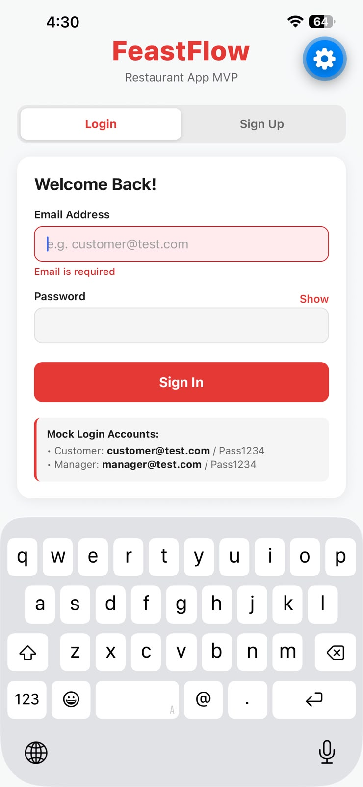

*Q3: Login form validation errors.*

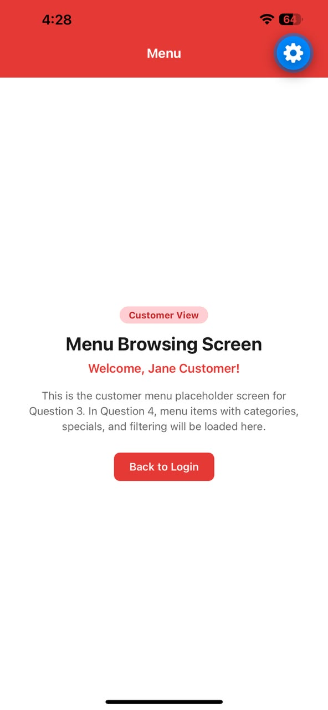

*Q3: Successful customer login.*

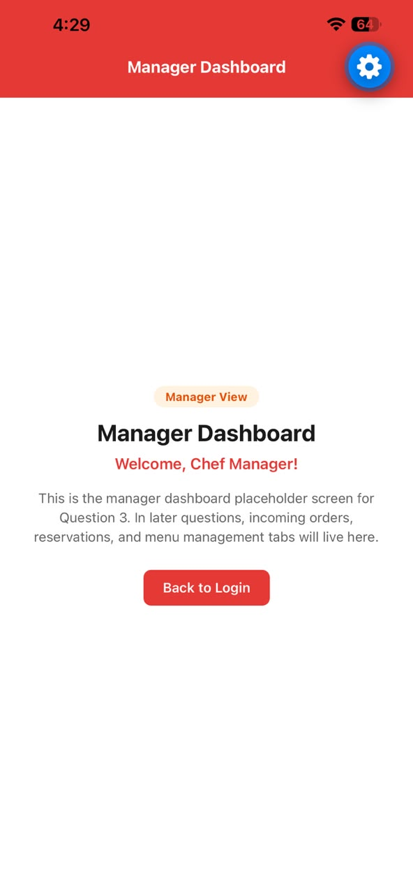

*Q3: Manager login.*

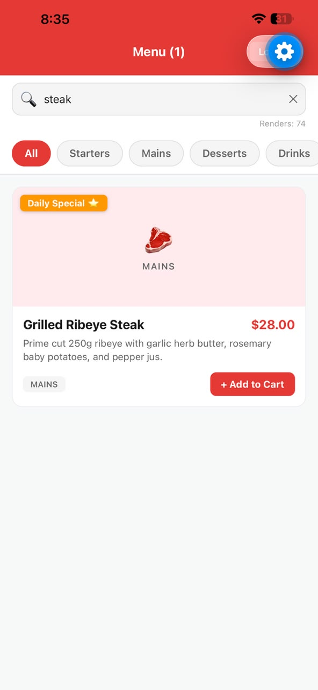

*Q5: Menu render counter.*

TODO: missing — A1 Q8 before-and-after MenuItemCard render comparison screenshot.

TODO: missing — A1 Q9 disabled reservation time slot screenshot.

## A2 Screenshots

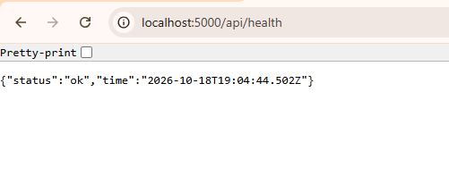

*Q2: Health endpoint response in the API testing tool.*

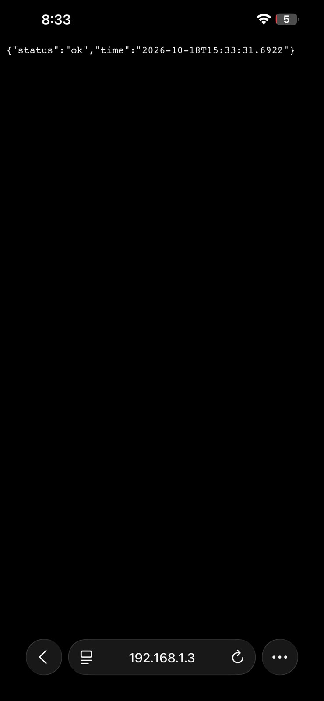

*Q2: Health endpoint opened in the phone browser.*

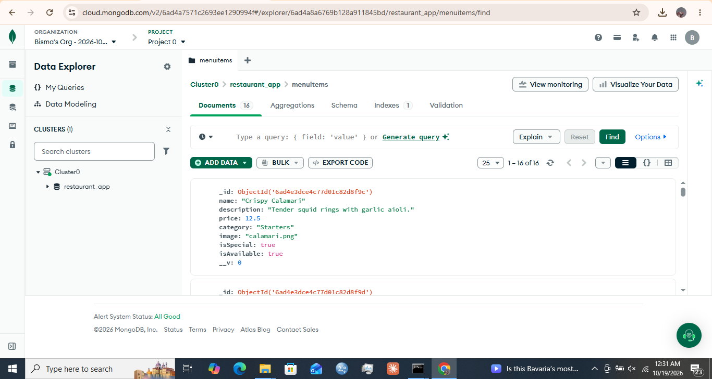

*Q3: Seeded `menuitems` collection in Atlas.*

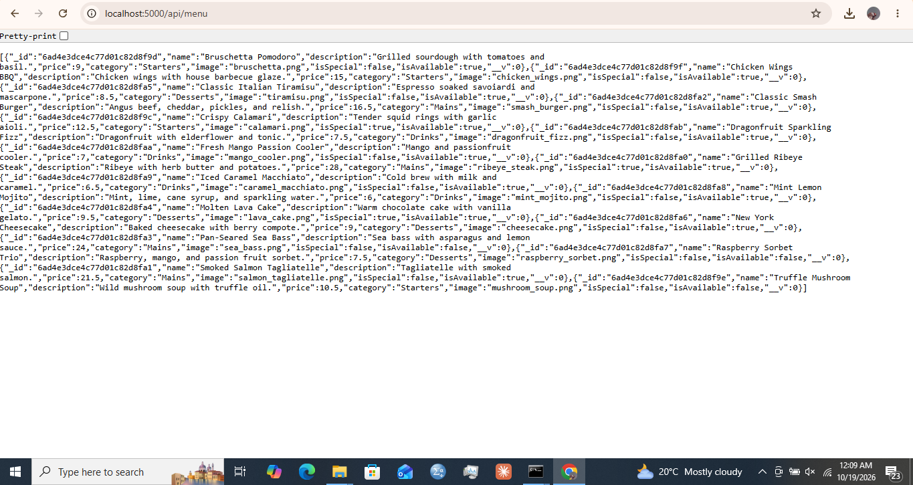

*Q4: Successful menu API request.*

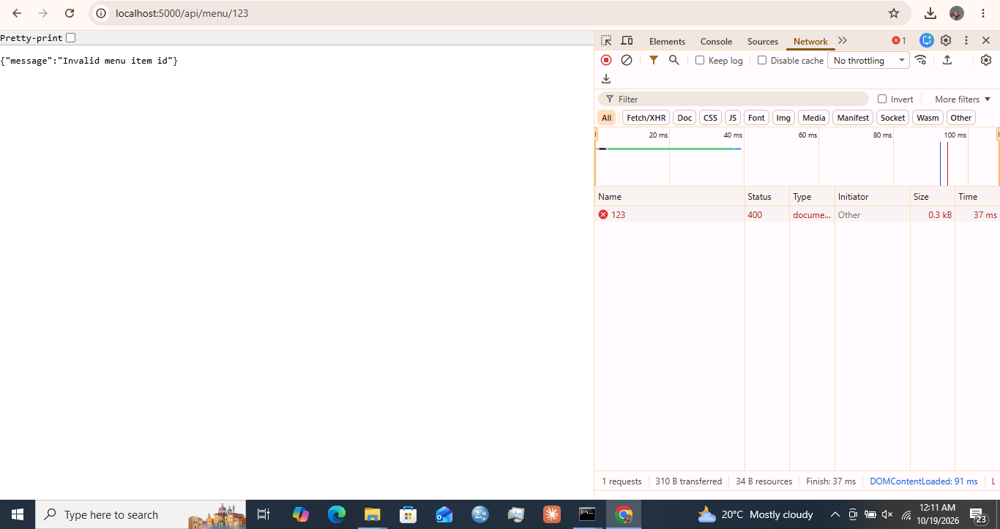

*Q4: Failed menu API request.*

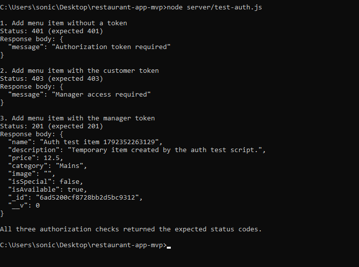

*Q5: Menu creation returns 401 without a token, 403 for a customer, and 201 for a manager.*

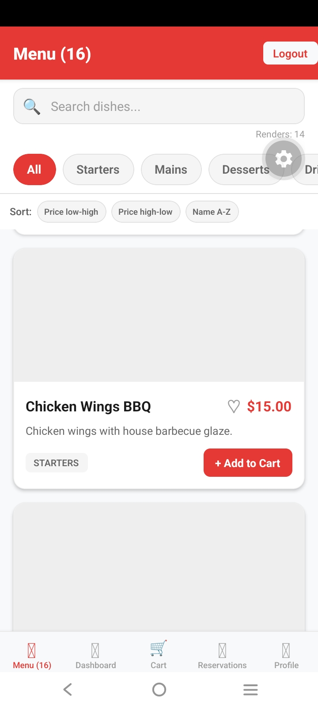

*Q6: Manager updates a menu price on device 1.*

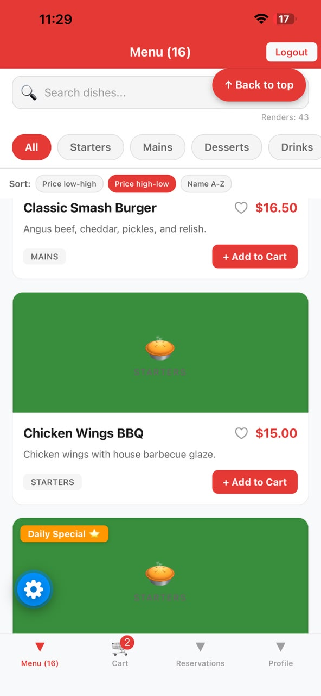

*Q6: Customer sees the updated price on device 2.*

## GitHub handoff

The working branch is `main`. `.env` files are ignored and must never be committed.
